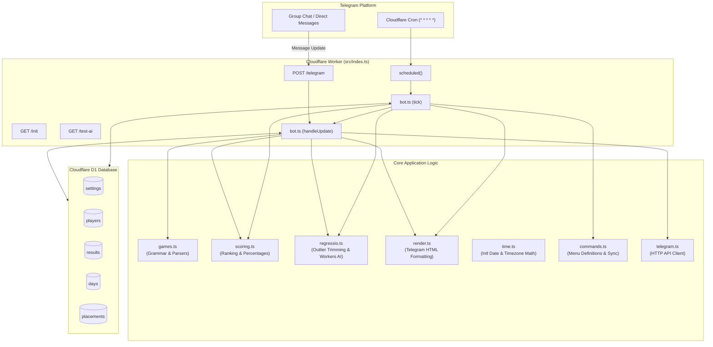

# dailybotti — Codebase Map & Architecture Reference

`dailybotti` is a serverless Telegram bot running on **Cloudflare Workers** with **Cloudflare D1** (SQLite) and **Cloudflare Workers AI** (Llama 3.3). It tracks and ranks daily browser puzzle games for a close-knit friend group (4 players):
1. **Eraly** (`eraly`) — Guessing historical event years (max 700 pts).
2. **Krillion** (`krillion`) — Daily marine dive (max 700 pts).
3. **Size It Up** (`sizeitup`) — Magnitude comparison across 5 rounds (max 500 pts).

The bot operates on a push-trigger model: players paste share text directly into the group or send it privately. A daily live board is edited in-place (`📋 Fri 23 Oct · today's board`), and podiums (`🏁 Results`) are posted when the day closes at `CLOSE_TIME` (default midnight) or automatically once all registered players finish all games.

---

## The Golden Rule

> [!IMPORTANT]
> **"Karppi puskee suoraan masteriin ja tuotantoon"**
> - All code changes and features are committed and pushed directly to `main`.
> - Changes are deployed immediately to production (`npx wrangler deploy` or via GitHub Actions).
> - No unnecessary feature branches or bureaucracy.

---

## Architecture & Data Flow



---

## Fast File Directory Map

| Path | Purpose & Key Responsibilities | Main Functions / Exports |
|---|---|---|
| [`src/index.ts`](file:///c:/Users/akseli/git/dailybotti/src/index.ts) | Worker entry point; routes HTTP webhook, `/init`, `/test-ai`, and cron schedules. | `fetch`, `scheduled`, `init`, `context`, `Env` |
| [`src/bot.ts`](file:///c:/Users/akseli/git/dailybotti/src/bot.ts) | Central bot orchestrator: update dispatch, command handling, board sync, day closure, and auto-finalize. | `handleUpdate`, `tick`, `finalizeDay`, `refreshBoard`, `recordResults`, `isDayComplete`, `regressioAction` |
| [`src/games.ts`](file:///c:/Users/akseli/git/dailybotti/src/games.ts) | Game registry, share text grammars, regex matchers, round extraction, and puzzle date mapping. | `GAMES`, `parseResults`, `parseRoundData`, `dayForResult`, `puzzleNumberFor`, `gameTitle` |
| [`src/db.ts`](file:///c:/Users/akseli/git/dailybotti/src/db.ts) | D1 SQLite queries and schema wrappers (settings, players, results, days, placements). | `getSettings`, `setSetting`, `upsertPlayer`, `allPlayers`, `insertResult`, `resultsForDay`, `getDay`, `saveBoard`, `savePlacements` |
| [`src/scoring.ts`](file:///c:/Users/akseli/git/dailybotti/src/scoring.ts) | Standings ranking algorithm (shared ranks 1-1-3), overall percentage sum (out of 300), and medals. | `rank`, `overallValue`, `dayStandings`, `placeMark`, `MEDALS` |
| [`src/regressio.ts`](file:///c:/Users/akseli/git/dailybotti/src/regressio.ts) | Statistical outlier removal (top 20%), blowout check (>20% win margin), Workers AI LLM prompts, and Finnish sports/esports fallbacks. | `calculateRegression`, `checkBlowout`, `generateExplanation`, `parseExplanation`, `FALLBACK_ITEMS`, `SYSTEM_PROMPT` |
| [`src/render.ts`](file:///c:/Users/akseli/git/dailybotti/src/render.ts) | Telegram HTML message renderers; escapes input, fits messages under 4000 chars, resolves duplicate names. | `renderBoard`, `renderSummary`, `renderLeaderboard`, `renderPlayerStats`, `renderRegressio`, `renderHelp`, `displayNames` |
| [`src/commands.ts`](file:///c:/Users/akseli/git/dailybotti/src/commands.ts) | Command menu lists for private chats and groups; synchronizes with Telegram `setMyCommands`. | `PRIVATE_COMMANDS`, `GROUP_COMMANDS`, `syncCommandMenus` |
| [`src/telegram.ts`](file:///c:/Users/akseli/git/dailybotti/src/telegram.ts) | Minimal Telegram Bot API fetch client; handles errors, supergroup migration, and message edit edge cases. | `createTelegram`, `TelegramError`, `isNotModified`, `isMessageGone` |
| [`src/time.ts`](file:///c:/Users/akseli/git/dailybotti/src/time.ts) | Timezone-aware date calculations with `Intl.DateTimeFormat` (default `Europe/Helsinki`), closure checks. | `localParts`, `isClosed`, `addDays`, `daysBetween`, `dayLabel` |
| [`wrangler.jsonc`](file:///c:/Users/akseli/git/dailybotti/wrangler.jsonc) | Cloudflare Worker configuration: D1 bindings, Workers AI binding, cron triggers, timezone vars. | Worker config schema |
| [`migrations/`](file:///c:/Users/akseli/git/dailybotti/migrations) | D1 SQL schema migrations (`0001_init.sql`, `0002_round_data.sql`, `0003_display_name.sql`). | Database schemas |
| [`test/`](file:///c:/Users/akseli/git/dailybotti/test) | Vitest test suite (`unit.test.ts`, `regressio.test.ts`, `bot.test.ts`, `helpers.ts`). | Unit & integration tests |
| [`.github/workflows/deploy.yml`](file:///c:/Users/akseli/git/dailybotti/.github/workflows/deploy.yml) | GitHub Actions CI/CD: runs typecheck, tests, applies migrations, and deploys Worker. | CI/CD pipeline |
| [`plan.md`](file:///c:/Users/akseli/git/dailybotti/plan.md) | Original design concept: share formats, point structures, cross-check math, push trigger flow. | Product design reference |
| [`README.md`](file:///c:/Users/akseli/git/dailybotti/README.md) | User setup instructions, command reference, deployment guide, and operational runbook. | User & admin docs |

---

## Supported Games & Parser Details

All parsing logic lives in [`src/games.ts`](file:///c:/Users/akseli/git/dailybotti/src/games.ts).

### 1. Eraly (`eraly`)
- **Max Score:** 700 (7 historical events, tiers 100/85/60/30/10/0).
- **Puzzle Numbering:** `#N` from anchor `2026-10-16` (player local midnight).
- **Share Format:**
  ```text
  Eraly #8 · I travelled to 1450 AD
  ▰▰▰▰▰▰▱▱▱▱ 420/700
  https://eraly.io
  ```
- **Regex:** `Eraly\s*#\s*(\d+)[\s\S]{0,200}?(?<!\d)(\d+)\s*\/\s*700(?!\d)`

### 2. Krillion (`krillion`)
- **Max Score:** 700 (sum of 7-symbol marine dive row: ⬛=0, 🫧=10, 🐟=30, 🦑=60, 🏮=85).
- **Puzzle Numbering:** `#N` from anchor `2026-07-16` (midnight New York time).
- **Share Format:**
  ```text
  Krillion #100 🦐
  540

  🫧🐟🦑🏮🌟⬛🤡
  https://krillion.io
  ```
- **Regex:** `Krillion[ \t]+#\s*(\d+)[^\n]*\n\s*(\d+)(?![\d.,])`
- **Rejections:** Unlimited (`∞`), archive (`⟲`), and themed variants (e.g. `🎃`) are explicitly rejected.
- **Round Breakdown:** Symbol extraction parsed with `Intl.Segmenter` for grapheme clusters.

### 3. Size It Up (`sizeitup`)
- **Max Score:** 500 (5 rounds, 0–100 each).
- **Puzzle Numbering:** **None**. Tied to local paste date (`today`).
- **Share Format:**
  ```text
  Size It Up
  Overall Score 461

  🟥🟥🟥🟥🟥 100
  🟥🟥🟥🟥⬜ 98*
  🟥🟥🟥🟥🟥 92
  🟥🟥🟥🟥⬜ 87
  🟥🟥🟥🟥🟥 84
  https://magnitudle.com/size-it-up
  ```
- **Regex:** `(?:^|\n)[ \t]*Size It Up[ \t]*\n\s*Overall Score[ \t]*(\d+(?:[.,]\d+)?)`
- **Rejections:** Pop Culture, Geography, Unlimited, Archive modes are rejected.
- **Round Breakdown:** Extracted per-round scores `[🟥⬜]{5} \d+` into JSON array.

---

## Scoring & Podium Lifecycle

Handled in [`src/scoring.ts`](file:///c:/Users/akseli/git/dailybotti/src/scoring.ts) and [`src/bot.ts`](file:///c:/Users/akseli/git/dailybotti/src/bot.ts).

### 1. Daily Overall Score
Overall score is the sum of percentage achievements across the 3 games, scaled out of 300:
$$\text{Overall} = \left(\frac{S_{\text{eraly}}}{700} + \frac{S_{\text{krillion}}}{700} + \frac{S_{\text{sizeitup}}}{500}\right) \times 100$$
Skipped games yield 0 points.

### 2. Standings & Ranking
- Highest score wins.
- Ties share a rank, skipping subsequent ranks (e.g., two 1st places $\to$ `🥇`, `🥇`, `🥉`).

### 3. Day Closure & Auto-Finalize
A day is finalized under two conditions:
1. **Clock expiration:** `isClosed()` returns true when current wall-clock time passes `CLOSE_TIME` (default `00:00` in `Europe/Helsinki`).
2. **Auto-finalize:** `isDayComplete()` verifies if all registered players (at least 4) have submitted all 3 games. If so, results are posted immediately without waiting for midnight.

### 4. Blowout Inspection ("Tilastovalvonta")
When a day closes, [`checkBlowout()`](file:///c:/Users/akseli/git/dailybotti/src/regressio.ts#L117) checks if the winner beat the runner-up by **$> 20\%$**.
If triggered:
- The winner's best single game is stripped.
- Cloudflare Workers AI (`@cf/meta/llama-3.3-70b-instruct-fp8-fast`) or a Finnish sports/esports fallback generates a satirical critique of the unsustainable performance.

---

## Statistical Regression Engine (`/regressio`)

Located in [`src/regressio.ts`](file:///c:/Users/akseli/git/dailybotti/src/regressio.ts) and [`src/render.ts`](file:///c:/Users/akseli/git/dailybotti/src/render.ts).

- **Concept:** Inspired by the legendary Patrick Mahomes regression meme. The bot strips the top 20% of scores (`Math.ceil(n * 0.2)`) as "unsustainable flukes" (*suonenvedot*).
- **Invocation:**
  - `/regressio`: Regresses caller or overall group leader.
  - `/regressio @username` or `/regressio name`: Targets a specific player.
  - Reply to a message containing game share text with `/regressio`: Analyzes and regresses that specific message's results.
- **Output:** Formatted with pseudo-scientific Finnish bureaucracy (*Hajonta- ja Kärykomissio*):
  - KARSINTA (e.g. *Hemohes-tason lääkärinlaukun antimia*)
  - JOHTOPÄÄTÖS (e.g. *Taantuu Juha Miedon tavoin ikuiseksi sadasosahäviäjäksi*)
  - LAUSUNTO (satirical expert commentary)

---

## Database Schema (Cloudflare D1)

| Table | Primary Key | Key Columns | Purpose |
|---|---|---|---|
| `settings` | `key` | `value` | Bot configuration (`group_chat_id`, `group_thread_id`, `bot_username`, `bot_id`, `command_menus`). |
| `players` | `id` (Telegram User ID) | `first_name`, `last_name`, `username`, `display_name`, `created_at` | Player identity and custom `/name` alias. |
| `results` | `(player_id, game, day)` | `puzzle`, `score`, `max_score`, `submitted_at`, `rounds_json`, `raw_text` | Idempotent first-submission storage. |
| `days` | `day` (`YYYY-MM-DD`) | `board_message_id`, `board_text`, `board_claim_until`, `finalized_at` | Tracks live group board message ID and lock status. |
| `placements` | `(day, category, player_id)` | `rank`, `value` | Closed day standings per game and overall. |

---

## Quick Developer Cheat Sheet

### Common Tasks & Where to Make Changes

| Task | Files to Edit |
|---|---|
| **Add or modify a game grammar** | [`src/games.ts`](file:///c:/Users/akseli/git/dailybotti/src/games.ts) (regex & `parseResults`), [`test/unit.test.ts`](file:///c:/Users/akseli/git/dailybotti/test/unit.test.ts) |
| **Add or modify a Telegram command** | [`src/commands.ts`](file:///c:/Users/akseli/git/dailybotti/src/commands.ts) (menu lists), [`src/bot.ts`](file:///c:/Users/akseli/git/dailybotti/src/bot.ts) (dispatcher & handlers) |
| **Adjust board or podium formatting** | [`src/render.ts`](file:///c:/Users/akseli/git/dailybotti/src/render.ts) (`renderBoard`, `renderSummary`) |
| **Tweak AI prompts or regression rules** | [`src/regressio.ts`](file:///c:/Users/akseli/git/dailybotti/src/regressio.ts) (`SYSTEM_PROMPT`, `calculateRegression`, `FALLBACK_ITEMS`) |
| **Modify database schema** | Add new migration in `migrations/000X_name.sql`, update types in [`src/db.ts`](file:///c:/Users/akseli/git/dailybotti/src/db.ts) |
| **Change group timezone or close time** | [`wrangler.jsonc`](file:///c:/Users/akseli/git/dailybotti/wrangler.jsonc) (`TIMEZONE`, `CLOSE_TIME`) |

### Local Testing & Deployment Commands

```sh
# Typecheck
npm run typecheck

# Run test suite
npm test

# Deploy directly to production (Karppi-sääntö!)
npx wrangler deploy

# Apply database migrations to remote D1
npx wrangler d1 migrations apply daily-games-bot --remote

# Tail production logs
npx wrangler tail
```
