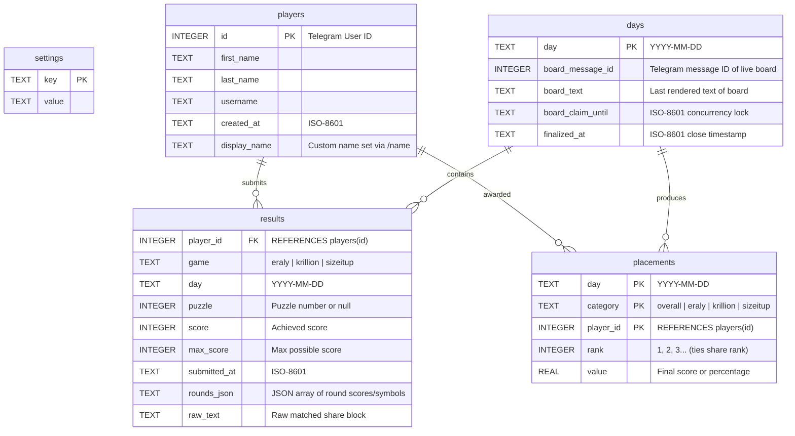
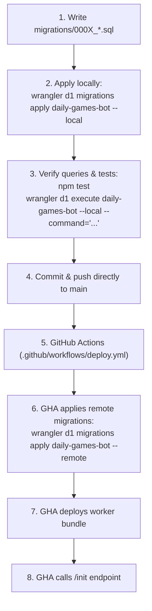

# Cloudflare D1 Migration & Database Flow

This skill covers the complete lifecycle of schema design, migrations, query patterns, and operational practices for **Cloudflare D1** (serverless SQLite) in `dailybotti`.

---

## The Golden Rule

> [!IMPORTANT]
> **"Karppi puskee suoraan masteriin ja tuotantoon"**
> - All schema migrations and code updates are committed and pushed directly to `main`.
> - Migrations are applied automatically to production via GitHub Actions CI/CD before worker deployment.
> - No unnecessary feature branches or bureaucracy.

---

## D1 Architecture & Schema Overview

`dailybotti` uses Cloudflare D1 as its primary persistence layer. The database binding is named `DB` in [`wrangler.jsonc`](file:///c:/Users/akseli/git/dailybotti/wrangler.jsonc), bound to the database `daily-games-bot` (`database_id: 0d15d449-8174-4853-901c-f166a7640e93`).



### Table Definitions & Roles

| Table | Primary Key | Purpose & Notes |
|---|---|---|
| [`settings`](file:///c:/Users/akseli/git/dailybotti/src/db.ts#L5-L36) | `key` | Global key-value store: `group_chat_id`, `group_thread_id`, `bot_username`, `bot_id`, `command_menus`. |
| [`players`](file:///c:/Users/akseli/git/dailybotti/src/db.ts#L38-L67) | `id` | Registered players (indexed by Telegram user ID). Stores Telegram profile details and custom `display_name`. |
| [`results`](file:///c:/Users/akseli/git/dailybotti/src/db.ts#L68-L126) | `(player_id, game, day)` | One row per player, game, and day. Deduplicated on submit. Has index `results_day(day)`. |
| [`days`](file:///c:/Users/akseli/git/dailybotti/src/db.ts#L127-L175) | `day` | Tracks live boards and finalization state (`finalized_at`). Indexed by `days_finalized(finalized_at)`. |
| [`placements`](file:///c:/Users/akseli/git/dailybotti/src/db.ts#L176-L223) | `(day, category, player_id)` | Final standings computed when a day closes. Feeds historical stats and `/leaderboard`. Indexed by `placements_player(player_id)`. |

---

## Migration History

All migrations live in the [`migrations/`](file:///c:/Users/akseli/git/dailybotti/migrations) directory:

1. **[`migrations/0001_init.sql`](file:///c:/Users/akseli/git/dailybotti/migrations/0001_init.sql)**
   - Created foundational tables: `settings`, `players`, `results`, `days`, `placements`.
   - Created foreign key references and indexes (`results_day`, `days_finalized`, `placements_player`).
2. **[`migrations/0002_round_data.sql`](file:///c:/Users/akseli/git/dailybotti/migrations/0002_round_data.sql)**
   - Added `rounds_json TEXT` to `results` (JSON array of round scores/emojis).
   - Added `raw_text TEXT` to `results` (preserves raw pasted share blocks for re-parsing/analysis).
3. **[`migrations/0003_display_name.sql`](file:///c:/Users/akseli/git/dailybotti/migrations/0003_display_name.sql)**
   - Added `display_name TEXT` to `players` (custom player display name set via `/name`).

---

## Creating a New Migration

### 1. Naming Convention

Migration filenames must follow strict chronological ordering:
```text
migrations/000X_<descriptive_snake_case_name>.sql
```
Examples:
- `migrations/0004_player_streaks.sql`
- `migrations/0005_add_game_metadata.sql`

> [!IMPORTANT]
> D1 reads migration files alphabetically and tracks applied files in an internal database table named `d1_migrations`. Do not rename or reorder existing migration files once they have been committed or applied.

### 2. SQLite DDL Constraints & Quirks in D1

Cloudflare D1 runs SQLite. SQLite has notable DDL constraints compared to PostgreSQL or MySQL:

- **Supported `ALTER TABLE` Operations:**
  - `ALTER TABLE table_name ADD COLUMN column_name data_type [column_constraint];`
  - Restrictions on added columns:
    - Cannot have `PRIMARY KEY` or `UNIQUE` constraints.
    - Default value cannot be `CURRENT_TIME`, `CURRENT_DATE`, `CURRENT_TIMESTAMP`, or dynamic expressions.
- **Unsupported / Restricted Operations:**
  - Cannot alter existing column types directly.
  - Cannot add or modify foreign key constraints on existing tables.
  - Cannot rename or drop columns without table rebuild in older SQLite engines.

### 3. The 12-Step SQLite Table Recreate Pattern

If a migration requires altering constraints, dropping columns, or restructuring a primary key, use SQLite's standard recreate strategy:

```sql
-- 1. Create temporary new table with desired schema
CREATE TABLE results_new (
  player_id INTEGER NOT NULL REFERENCES players(id),
  game TEXT NOT NULL,
  day TEXT NOT NULL,
  score INTEGER NOT NULL,
  max_score INTEGER NOT NULL,
  submitted_at TEXT NOT NULL,
  rounds_json TEXT,
  raw_text TEXT,
  PRIMARY KEY (player_id, game, day)
);

-- 2. Copy existing data
INSERT INTO results_new (player_id, game, day, score, max_score, submitted_at, rounds_json, raw_text)
SELECT player_id, game, day, score, max_score, submitted_at, rounds_json, raw_text
FROM results;

-- 3. Drop old table
DROP TABLE results;

-- 4. Rename new table to original name
ALTER TABLE results_new RENAME TO results;

-- 5. Recreate indexes
CREATE INDEX results_day ON results(day);
```

### 4. Idempotency & Safety

Always write migrations defensively:
- Use `CREATE TABLE IF NOT EXISTS ...` where appropriate.
- Use `CREATE INDEX IF NOT EXISTS ...`.
- Keep migrations granular — one logical schema change per migration file.

---

## Migration Execution & Testing Lifecycle



### 1. Local Testing

Before pushing, apply and test the migration against the local D1 SQLite database:

```bash
# Apply pending migrations to local SQLite environment (.wrangler/state/v3/d1)
npx wrangler d1 migrations apply daily-games-bot --local

# Verify table structure locally
npx wrangler d1 execute daily-games-bot --local --command="PRAGMA table_info(results);"

# Inspect existing rows locally
npx wrangler d1 execute daily-games-bot --local --command="SELECT * FROM players LIMIT 5;"

# Run the test suite
npm test
```

### 2. Automated Production Migrations (CI/CD)

Production migrations run automatically in [`.github/workflows/deploy.yml`](file:///c:/Users/akseli/git/dailybotti/.github/workflows/deploy.yml):

```yaml
# Runs BEFORE worker deployment so new code always finds expected columns:
- name: Apply database migrations
  uses: cloudflare/wrangler-action@v3
  with:
    apiToken: ${{ secrets.CLOUDFLARE_API_TOKEN }}
    accountId: ${{ secrets.CLOUDFLARE_ACCOUNT_ID }}
    command: d1 migrations apply daily-games-bot --remote
```

- Wrangler checks the remote `d1_migrations` table.
- Already-applied migrations are skipped with zero downtime.
- If a migration fails, CI/CD stops immediately before deploying the worker bundle.

### 3. Manual Production Operations

To run migrations manually or query production data from the CLI:

```bash
# Check migration status in production
npx wrangler d1 migrations list daily-games-bot --remote

# Manually apply pending migrations in production
npx wrangler d1 migrations apply daily-games-bot --remote

# Query production tables directly
npx wrangler d1 execute daily-games-bot --remote --command="SELECT COUNT(*) AS total_results FROM results;"

# Run an ad-hoc SQL script against production
npx wrangler d1 execute daily-games-bot --remote --file=./scratch/diagnostic.sql
```

---

## Code-Level Practices in `src/db.ts`

All database interactions are encapsulated in [`src/db.ts`](file:///c:/Users/akseli/git/dailybotti/src/db.ts).

### 1. Prepared Statements & Parameter Binding

Always bind parameters with `?` placeholders to guarantee SQL injection immunity:

```typescript
// Good: Parameter binding
const row = await db
  .prepare("SELECT * FROM results WHERE player_id = ? AND game = ? AND day = ?")
  .bind(playerId, game, day)
  .first<ResultRow>();

// Bad: String concatenation (Never do this)
// db.prepare(`SELECT * FROM results WHERE day = '${day}'`)
```

### 2. Dual-Writing & Backward-Compatible Queries

When adding new columns that the worker starts writing to, provide graceful fallbacks in case code deploys before migrations apply, or during local test transitions:

```typescript
// Pattern from src/db.ts insertResult():
export async function insertResult(db: D1Database, r: ResultRow): Promise<boolean> {
  try {
    const res = await db
      .prepare(
        `INSERT INTO results (player_id, game, day, puzzle, score, max_score, submitted_at, rounds_json, raw_text)
         VALUES (?, ?, ?, ?, ?, ?, ?, ?, ?)
         ON CONFLICT(player_id, game, day) DO NOTHING`,
      )
      .bind(r.player_id, r.game, r.day, r.puzzle, r.score, r.max_score, r.submitted_at, r.rounds_json ?? null, r.raw_text ?? null)
      .run();
    return res.meta.changes > 0;
  } catch (err) {
    // If the database has not yet received the new columns, fall back to the legacy schema:
    if (!(err instanceof Error) || !/no such column/i.test(err.message)) throw err;
    const res = await db
      .prepare(
        `INSERT INTO results (player_id, game, day, puzzle, score, max_score, submitted_at)
         VALUES (?, ?, ?, ?, ?, ?, ?)
         ON CONFLICT(player_id, game, day) DO NOTHING`,
      )
      .bind(r.player_id, r.game, r.day, r.puzzle, r.score, r.max_score, r.submitted_at)
      .run();
    return res.meta.changes > 0;
  }
}
```

### 3. Atomic Batches with `db.batch()`

For multi-row transactions where all statements must succeed or fail together, use `db.batch()`:

```typescript
// Pattern from src/db.ts savePlacements():
export async function savePlacements(db: D1Database, day: string, rows: PlacementRow[]): Promise<void> {
  const insert = db.prepare("INSERT INTO placements (day, category, player_id, rank, value) VALUES (?, ?, ?, ?, ?)");
  await db.batch([
    db.prepare("DELETE FROM placements WHERE day = ?").bind(day),
    ...rows.map((r) => insert.bind(day, r.category, r.playerId, r.rank, r.value)),
  ]);
}
```

### 4. Concurrency Protection & Ephemeral Locks

`dailybotti` prevents duplicate live board posts using an expiring claim column (`board_claim_until`):

```typescript
// Pattern from src/db.ts claimBoardPost():
export async function claimBoardPost(db: D1Database, day: string, nowIso: string, untilIso: string): Promise<boolean> {
  const res = await db
    .prepare(
      `UPDATE days SET board_claim_until = ?
       WHERE day = ? AND board_message_id IS NULL AND (board_claim_until IS NULL OR board_claim_until < ?)`,
    )
    .bind(untilIso, day, nowIso)
    .run();
  return res.meta.changes > 0;
}
```

---

## Migration Troubleshooting & Recovery

| Issue | Cause | Resolution |
|---|---|---|
| `table already exists` | Missing `IF NOT EXISTS` in migration script. | Edit migration script to add `IF NOT EXISTS` or check `d1_migrations` table. |
| `no such column: ...` | Worker code querying column before migration ran. | Ensure CI/CD applies migrations prior to worker deploy; add try/catch fallback in `db.ts`. |
| Migration stuck / out of order | Manual edits in D1 or skipped migration numbers. | Check applied list: `npx wrangler d1 migrations list daily-games-bot --remote`. |
| SQLite lock timeout | Long-running queries during migration batch. | Keep batch operations scoped; avoid large unindexed table scans. |
| Column addition rejected | Attempted `ADD COLUMN` with `UNIQUE` or `PRIMARY KEY`. | Use the 12-Step SQLite Table Recreate pattern described above. |
