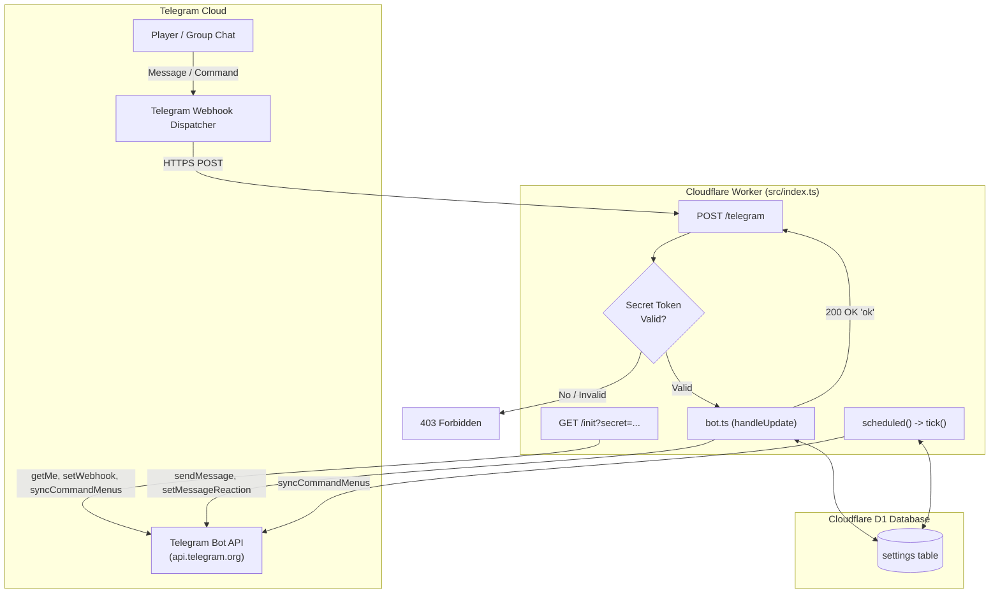
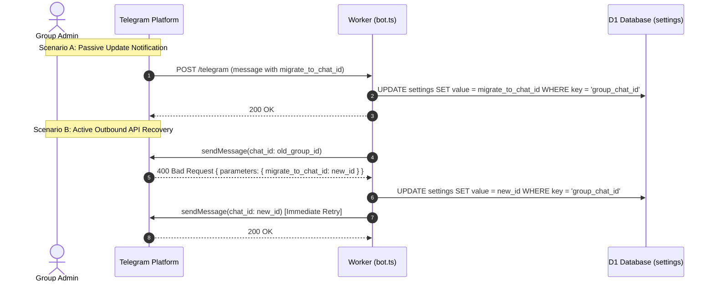

# Telegram Bot Operations & Architecture

This skill provides an in-depth operational and architectural guide to `dailybotti`'s Telegram Bot integration, covering webhook security, automated initialization, dynamic command menus, supergroup migrations, HTML formatting, and live debugging.

---

## The Golden Rule

> [!IMPORTANT]
> **"Karppi puskee suoraan masteriin ja tuotantoon"**
> - All bot improvements, command changes, and fixes are committed and pushed directly to `main`.
> - Changes deploy immediately to production via GitHub Actions or `npx wrangler deploy`.
> - No unnecessary feature branches or bureaucracy.

---

## Telegram Bot Architecture Overview

`dailybotti` communicates with Telegram over an HTTPS Webhook hosted on Cloudflare Workers.



### Inbound Webhook (`POST /telegram`)

- **Path:** `/telegram` in [`src/index.ts`](file:///c:/Users/akseli/git/dailybotti/src/index.ts#L81-L105).
- **Authentication:** Telegram transmits the secret header `X-Telegram-Bot-Api-Secret-Token`.
  - The worker validates this header against `env.WEBHOOK_SECRET`.
  - Mismatch or missing header immediately returns `403 Forbidden`.
- **Acknowledgment Semantics:**
  - The endpoint always returns `200 OK` with body `"ok"` once the payload is parsed, even if internal processing throws an error:
    ```typescript
    // src/index.ts: Always acknowledge, so Telegram doesn't keep resending an update that fails.
    return new Response("ok");
    ```
  - This prevents **retry storms**, where a single unhandled edge case causes Telegram to resend the update repeatedly, exhausting Cloudflare Worker request quotas.
  - If a command or private message triggers an unexpected exception, the bot catches it and sends an apology message to the user (`"Sorry, something went wrong. Please try again in a minute."`).

---

## Bot Initialization & Webhook Registration (`/init`)

The bot provides a dedicated initialization endpoint: `GET /init?secret=<WEBHOOK_SECRET>`.

### Step-by-Step Initialization Logic

When called, [`init()`](file:///c:/Users/akseli/git/dailybotti/src/index.ts#L31-L75) performs complete end-to-end health verification and registration:

1. **Environment Validation:**
   - Verifies `TELEGRAM_BOT_TOKEN` exists.
   - Validates `WEBHOOK_SECRET` matches `/^[A-Za-z0-9_-]{16,256}$/`.
   - Validates `TIMEZONE` using `Intl.DateTimeFormat`.
   - Validates `CLOSE_TIME` format (e.g. `"00:00"`).
2. **Database Verification:**
   - Runs `SELECT COUNT(*) FROM settings` to confirm D1 migrations have run.
3. **Telegram Identity Sync:**
   - Calls `tg.call("getMe")` to verify credentials.
   - Saves `bot_id` and `bot_username` into the `settings` table.
4. **Webhook Registration:**
   - Resolves the webhook URL (`${origin}/telegram`).
   - Calls `tg.call("setWebhook")` with:
     - `url: webhookUrl`
     - `secret_token: env.WEBHOOK_SECRET`
     - `allowed_updates: ["message"]`
     - `max_connections: 1` (strict ordering, avoids race conditions)
5. **Command Menu Registration:**
   - Forces command menu sync (`syncCommandMenus(env.DB, tg, null, true)`).

### CI/CD Automation

In [`.github/workflows/deploy.yml`](file:///c:/Users/akseli/git/dailybotti/.github/workflows/deploy.yml#L50-L52), the `/init` endpoint is automatically triggered right after deployment:

```yaml
- name: Initialize bot & update webhook/commands
  run: |
    curl -s -S -f "https://daily-games-bot.daily-games-bot.workers.dev/init?secret=${{ secrets.WEBHOOK_SECRET }}"
```

### Manual Trigger

You can manually trigger `/init` using curl or your browser:

```bash
curl -s -S -f "https://daily-games-bot.daily-games-bot.workers.dev/init?secret=YOUR_WEBHOOK_SECRET"
```

Expected output:
```text
✅ Config: timezone Europe/Helsinki, results close at midnight
✅ Database tables exist
✅ Bot token works: @daily_games_bot
✅ Webhook set to https://daily-games-bot.daily-games-bot.workers.dev/telegram
✅ Command menu set

All done. Next: add the bot to your group, make it an admin, and send /setup in the group.
```

---

## Dynamic Command Menus (`src/commands.ts`)

Telegram allows bots to define slash command menus via `setMyCommands`. `dailybotti` maintains separate menus for private direct messages and group chats in [`src/commands.ts`](file:///c:/Users/akseli/git/dailybotti/src/commands.ts):

| Command | Scope | Description |
|---|---|---|
| `/today` | Private & Group | Show today's live board |
| `/me` | Private & Group | Show personal stats and medals |
| `/leaderboard` | Private & Group | All-time rankings and gold medals |
| `/regressio` | Private & Group | Statistical outlier analysis |
| `/name` | Private & Group | Set custom display name on boards |
| `/help` | Private & Group | Instructions and game rules |
| `/setup` | Group only | Link bot to the group (admins) |

### Automatic Minute-by-Minute Menu Sync

Instead of requiring manual re-initialization whenever commands are edited, [`syncCommandMenus()`](file:///c:/Users/akseli/git/dailybotti/src/commands.ts#L32-L38) automates menu updates:

```typescript
export async function syncCommandMenus(db: D1Database, tg: Telegram, lastSent: string | null, force = false): Promise<boolean> {
  if (!force && lastSent === COMMAND_MENUS) return false;
  await tg.call("setMyCommands", { commands: PRIVATE_COMMANDS, scope: { type: "all_private_chats" } });
  await tg.call("setMyCommands", { commands: GROUP_COMMANDS, scope: { type: "all_group_chats" } });
  await setSetting(db, "command_menus", COMMAND_MENUS);
  return true;
}
```

1. The serialized JSON of all menus (`COMMAND_MENUS`) is compared against the database `settings.command_menus`.
2. This runs every minute inside `tick()` via the Cloudflare Cron trigger (`* * * * *`).
3. If code changes `PRIVATE_COMMANDS` or `GROUP_COMMANDS`, Telegram's UI updates within 60 seconds without downtime or redeploying `/init`.

---

## Group Chat Lifecycle & Supergroup Migration

In Telegram, standard groups (negative IDs like `-123456789`) automatically upgrade to **supergroups** (`-100...` IDs) when features like message history, topics, or member limits change.

`dailybotti` handles chat migration seamlessly via two complementary mechanisms:



### 1. Passive Update Handling
When Telegram performs an upgrade, it sends a service message with `migrate_to_chat_id`:
```typescript
// src/bot.ts handleUpdate():
if (msg.migrate_to_chat_id && msg.chat.id === settings.groupChatId) {
  await setSetting(ctx.db, "group_chat_id", msg.migrate_to_chat_id);
  return;
}
```

### 2. Active Outbound API Recovery
If the bot attempts to post to the old group ID before receiving the migration update, Telegram rejects the API call with error code 400 and `parameters.migrate_to_chat_id`.

[`sendToGroup()`](file:///c:/Users/akseli/git/dailybotti/src/bot.ts#L117-L126) catches this error via `TelegramError`, updates `group_chat_id` in D1, and immediately retries the message to the new supergroup ID:
```typescript
async function sendToGroup(ctx: Ctx, settings: Settings, text: string, opts: SendOptions = {}): Promise<Message> {
  try {
    return await send(ctx, settings.groupChatId!, text, { ...opts, threadId: settings.groupThreadId });
  } catch (err) {
    if (!(err instanceof TelegramError) || !err.migrateToChatId) throw err;
    await setSetting(ctx.db, "group_chat_id", err.migrateToChatId);
    settings.groupChatId = err.migrateToChatId;
    return send(ctx, settings.groupChatId, text, { ...opts, threadId: settings.groupThreadId });
  }
}
```

---

## Message Formatting, Limits & Reaction Mechanics

### 1. HTML Formatting & Sanitization

All messages use Telegram's HTML parse mode (`parse_mode: "HTML"`), and link previews are disabled (`link_preview_options: { is_disabled: true }`).

To prevent malformed entities or HTML injection from player names and custom strings, all external strings must pass through `escapeHtml()` in [`src/render.ts`](file:///c:/Users/akseli/git/dailybotti/src/render.ts#L11-L13):

```typescript
export function escapeHtml(s: string): string {
  return s.replace(/&/g, "&amp;").replace(/</g, "&lt;").replace(/>/g, "&gt;");
}
```

### 2. The 4000 Character Limit & `fit()`

Telegram enforces a strict limit of 4096 characters per message. Blindly truncating a string at character 4000 can sever HTML tags (e.g. cutting off `<b` or `<i`), causing Telegram to reject the message with `400 Bad Request: can't parse entities: Tag was not closed`.

[`fit()`](file:///c:/Users/akseli/git/dailybotti/src/render.ts#L16-L28) safely truncates messages line-by-line:

```typescript
const MAX_LENGTH = 4000;

function fit(lines: string[]): string {
  const out: string[] = [];
  let length = 0;
  for (const line of lines) {
    if (length + line.length + 1 > MAX_LENGTH - 2) {
      out.push("…");
      break;
    }
    out.push(line);
    length += line.length + 1;
  }
  return out.join("\n");
}
```

### 3. Non-Intrusive Emoji Reactions (`setMessageReaction`)

When players post game scores into the group chat, the bot confirms valid results by reacting with a 👍 emoji (`setMessageReaction`) rather than posting a chat reply:

```typescript
// src/bot.ts groupResults():
const issues = [...outcome.problems, ...parsed.rejected];
const reacted =
  issues.length === 0 &&
  (await tryCall(ctx, "setMessageReaction", {
    chat_id: msg.chat.id,
    message_id: msg.message_id,
    reaction: [{ type: "emoji", emoji: "👍" }],
  }));

// Bot only posts a reply message if something went wrong or reactions aren't supported:
if (!reacted) await reply(ctx, msg, [...outcome.saved, ...issues].join("\n"));
```

**Benefits:**
- Eliminates bot reply clutter in the group chat.
- Players receive immediate feedback that their puzzle score was parsed and saved.
- Text replies are reserved exclusively for issues (e.g. late submissions, duplicate attempts, rejected archive games).

---

## Production Operations & Debugging Runbook

### 1. Real-Time Log Streaming (`wrangler tail`)

To monitor live production traffic, incoming webhooks, cron ticks, and AI prompts:

```bash
npx wrangler tail daily-games-bot
```

Filter tail events:
```bash
# Filter only error logs
npx wrangler tail daily-games-bot --status error

# Filter for specific search term
npx wrangler tail daily-games-bot --search "setMessageReaction"
```

### 2. Inspecting Telegram Webhook Health

To diagnose delivery issues, check Telegram's webhook diagnostic endpoint:

```bash
# Substitute your bot token:
curl -s "https://api.telegram.org/bot<TELEGRAM_BOT_TOKEN>/getWebhookInfo" | jq
```

Key response fields to inspect:
- `url`: Must match `https://daily-games-bot.daily-games-bot.workers.dev/telegram`.
- `has_custom_certificate`: `false` (Cloudflare manages TLS).
- `pending_update_count`: Should be `0` under normal operation. If elevated (>10), updates are backing up or failing.
- `last_error_date` & `last_error_message`: Shows any network/HTTP failure Telegram encountered when contacting the Worker.
- `max_connections`: Should be `1`.

### 3. Testing Worker Endpoints

| Endpoint | Method | Purpose | Example Command |
|---|---|---|---|
| `/` | `GET` | Health check | `curl -s https://daily-games-bot.daily-games-bot.workers.dev/` |
| `/init` | `GET` | Bot setup & webhook sync | `curl -s "https://daily-games-bot.daily-games-bot.workers.dev/init?secret=$SECRET"` |
| `/test-ai` | `GET` | Workers AI model test | `curl -s "https://daily-games-bot.daily-games-bot.workers.dev/test-ai?secret=$SECRET&name=Testi"` |

### 4. Common Operational Issues

| Symptom | Diagnostic | Fix |
|---|---|---|
| Bot ignores group messages | Check privacy mode with `/init` or `getMe`. | In `@BotFather`, disable Group Privacy (`/setprivacy -> Disable`) so the bot can read all puzzle shares. |
| Webhook returns `403 forbidden` | `WEBHOOK_SECRET` header mismatch. | Re-run `/init?secret=...` to sync the secret token with Telegram. |
| `can't parse entities` error | Malformed HTML or truncated tags. | Ensure user-provided strings pass through `escapeHtml()` and multi-line reports use `fit()`. |
| Podium not posting at midnight | Cron trigger or timezone mismatch. | Verify `TIMEZONE` in `wrangler.jsonc` and check `openDays(db)` via `wrangler d1 execute`. |
